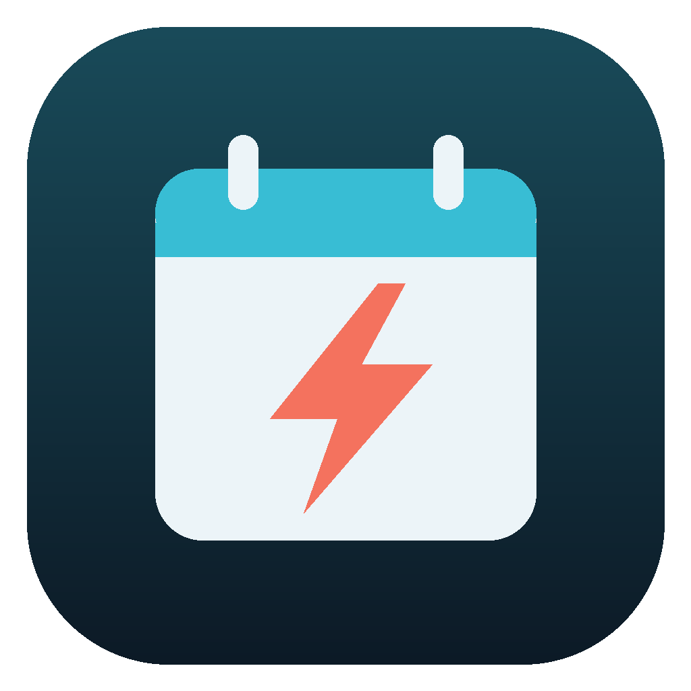

<h1 align="center">Migraine Diary</h1>

  Дневник мигрени: записи, календарь, отчёты и аналитика в одном файле. 
  Migraine diary: entries, calendar, reports and analytics in a single file.

  <a href="https://github.com/Finn013/MigraineDiary/releases/latest">Скачать / Download</a> ·
  <a href="https://finn013.github.io/MigraineDiary/">Открыть онлайн / Open online</a>

---

## 🇷🇺 О приложении
Помогает замечать, что провоцирует приступы и что помогает. Все данные остаются на устройстве, интернет не нужен.

### Возможности
- **Полная и быстрая запись**: дата, время начала, сила боли 0–10, длительность, стресс, сон, вода, питание, погода/давление.
- **Лекарства**: дозировка, эффект («помогло», «частично», «не помогло») и через сколько минут.
- **Триггеры и симптомы** — свои списки, можно редактировать.
- Отметка «важная запись», дни без боли тоже учитываются.
- **Календарь** с цветом по интенсивности и **график** боли.
- **Фильтры**: период, тип дня, сила боли, лекарство, триггер, симптом.
- **Аналитика**: дни с болью и без, средняя боль и длительность, максимум, паттерны.
- **Отчёты** за 7 дней, 30 дней, месяц, сравнение с прошлым периодом и **краткий отчёт для врача**.
- Темы (тёмные и светлые), размер текста, плотность, свои цвета.
- Автосохранение, экспорт и импорт JSON.

### Скачать
| Платформа | Файл |
|---|---|
| Любое устройство с браузером | `MigraineDiary.html` |
| Android 7+ | `MigraineDiary.apk` |
| Windows 10/11 | `MigraineDiary-Setup.exe` (установщик) или `MigraineDiary-Portable.exe` (без установки) |
| iPhone, iPad, Mac | [finn013.github.io/MigraineDiary](https://finn013.github.io/MigraineDiary/) |

Windows-сборки не подписаны: если SmartScreen предупредит, нажмите «Подробнее» → «Выполнить в любом случае».

> Дневник не заменяет консультацию врача.

---

## 🇬🇧 About
Helps you notice what triggers attacks and what helps. All data stays on your device, no internet needed.

### Features
- **Full and quick entry**: date, start time, pain 0–10, duration, stress, sleep, water, food, weather/pressure.
- **Medication**: dose, effect (“helped”, “partly”, “didn’t help”) and how many minutes until relief.
- **Triggers and symptoms** — your own editable lists.
- “Important” flag; pain-free days are tracked too.
- **Calendar** colored by intensity and a pain **chart**.
- **Filters**: period, day type, pain level, medication, trigger, symptom.
- **Analytics**: days with and without pain, average pain and duration, maximum, patterns.
- **Reports** for 7 days, 30 days, month, comparison with the previous period and a **short report for your doctor**.
- Themes (dark and light), text size, density, custom colors.
- Autosave, JSON export and import.

### Download
| Platform | File |
|---|---|
| Any device with a browser | `MigraineDiary.html` |
| Android 7+ | `MigraineDiary.apk` |
| Windows 10/11 | `MigraineDiary-Setup.exe` (installer) or `MigraineDiary-Portable.exe` (no install) |
| iPhone, iPad, Mac | [finn013.github.io/MigraineDiary](https://finn013.github.io/MigraineDiary/) |

Windows builds are unsigned: if SmartScreen warns, click “More info” → “Run anyway”.

> This diary does not replace medical advice.
